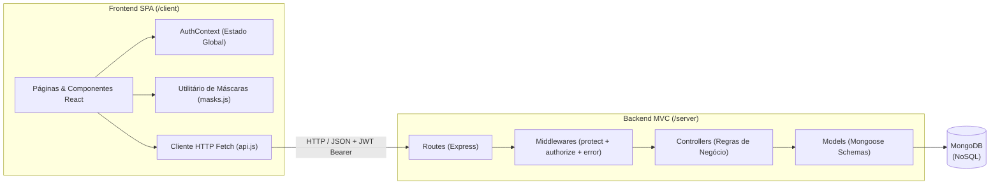
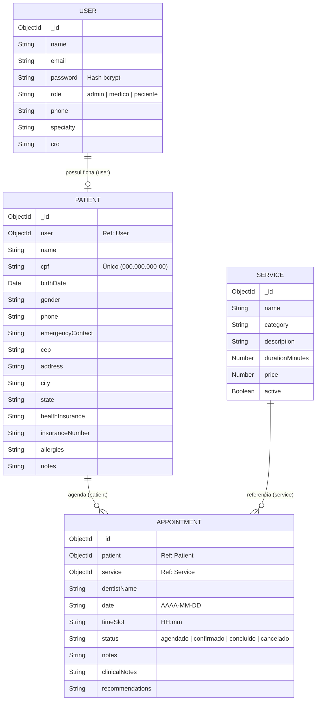

# 🦷 OdontoCheck — Sistema Full Stack de Gestão e Agendamento Odontológico

> **Disciplina:** DDC704 — Arquitetura e Tecnologias de Sistemas Web (UFRR)  
> **Autores:** Andersson & Igor  
> **Tema:** Sistema de Agendamento e Gestão Clínica Odontológica (Opção 3)

O **OdontoCheck** é uma aplicação web completa (**Full Stack**) desenvolvida na arquitetura **MVC** no Backend (**Node.js + Express + MongoDB/Mongoose**) e **SPA Componentizada** no Frontend (**React 18 + Vite + Tailwind CSS + React Router**). O sistema gerencia o fluxo completo de uma clínica odontológica — desde o cadastro completo do paciente com máscaras em tempo real e agendamento online com bloqueio de conflito de horários, até o prontuário eletrônico do cirurgião-dentista e os relatórios gerenciais do administrador.

---

## Sumário

1. [Visão Geral da Arquitetura](#1-visão-geral-da-arquitetura)
2. [Tecnologias Utilizadas](#2-tecnologias-utilizadas)
3. [Controle de Acesso e Permissões (RBAC)](#3-controle-de-acesso-e-permissões-rbac)
4. [Modelagem de Dados (MongoDB / Mongoose)](#4-modelagem-de-dados-mongodb--mongoose)
5. [Documentação da API RESTful (Endpoints)](#5-documentação-da-api-restful-endpoints)
6. [Arquitetura de Componentes no Frontend](#6-arquitetura-de-componentes-no-frontend)
7. [Formatação e Limites de Entrada (Máscaras)](#7-formatação-e-limites-de-entrada-máscaras)
8. [Como Executar o Projeto (Docker e Local)](#8-como-executar-o-projeto-docker-e-local)
9. [Contas de Demonstração (Seed Inicial)](#9-contas-de-demonstração-seed-inicial)
10. [Roteiro de Apresentação em Sala (3–5 min)](#10-roteiro-de-apresentação-em-sala-35-min)

---

## 1. Visão Geral da Arquitetura

O projeto é dividido em duas camadas principais desacopladas (`/server` e `/client`), comunicando-se via **JSON REST API** autenticada com **JWT (Bearer Token)**:



### Estrutura de Diretórios

```text
projeto_final_WEB_DDC704_Andersson_Igor/
├── Dockerfile                        # Build multi-stage unificado para deploy em nuvem (Railway)
├── docker-compose.yml                # Orquestração local (MongoDB 7 + Server API + Client Nginx)
├── package.json                      # Scripts utilitários da raiz (install:all, dev, seed, build)
├── server/                           # Backend (Node.js + Express + Mongoose)
│   ├── Dockerfile
│   ├── docker-entrypoint.sh          # Aguarda o MongoDB e executa o seed automaticamente
│   └── src/
│       ├── config/
│       │   ├── db.js                 # Conexão com o MongoDB
│       │   └── jwt.js                # Assinatura e verificação de tokens JWT
│       ├── models/
│       │   ├── User.js               # Usuários autenticáveis (admin, medico, paciente) + bcrypt
│       │   ├── Patient.js            # Ficha cadastral completa e anamnese do paciente
│       │   ├── Service.js            # Catálogo de procedimentos odontológicos
│       │   └── Appointment.js        # Agendamentos, evolução clínica e recomendações
│       ├── controllers/
│       │   ├── authController.js     # Registro completo, login, sessão (/me) e listagem de médicos
│       │   ├── patientController.js  # CRUD de pacientes, ficha própria (/me) e histórico clínico
│       │   ├── serviceController.js  # CRUD do catálogo de procedimentos
│       │   ├── appointmentController.js # Agendamentos, verificação de conflitos e relatórios
│       │   └── shared.js             # Funções auxiliares e vínculo automático User <-> Patient
│       ├── middleware/
│       │   ├── authMiddleware.js     # Autenticação JWT (protect) e autorização por perfil (authorize)
│       │   └── errorMiddleware.js    # Tratamento centralizado de erros e validações do Mongoose
│       ├── routes/
│       │   ├── authRoutes.js
│       │   ├── patientRoutes.js
│       │   ├── serviceRoutes.js
│       │   └── appointmentRoutes.js
│       ├── scripts/
│       │   └── seed.js               # População inicial automática do banco de dados
│       └── server.js                 # Ponto de entrada da API Express
└── client/                           # Frontend (React 18 + Vite + Tailwind CSS)
    ├── Dockerfile
    ├── nginx.conf
    └── src/
        ├── components/               # Componentes reutilizáveis e modulares
        ├── context/
        │   └── AuthContext.jsx       # Gerenciamento de sessão, token JWT e perfil RBAC
        ├── pages/                    # Páginas da SPA
        ├── services/
        │   └── api.js                # Cliente HTTP Fetch com injeção automática do token Bearer
        ├── utils/
        │   └── masks.js              # Formatação em tempo real e limites de caracteres
        └── App.jsx                   # Roteamento SPA e proteção de rotas por perfil
```

---

## 2. Tecnologias Utilizadas

| Camada | Tecnologia | Finalidade |
| :--- | :--- | :--- |
| **Backend** | Node.js 20 + Express 4 | Servidor HTTP e roteamento RESTful na arquitetura MVC |
| **Banco de Dados** | MongoDB 7 + Mongoose 8 | Persistência NoSQL, relacionamentos (`ObjectId` / `populate`) e validações de schema |
| **Segurança** | `bcryptjs` + `jsonwebtoken` (JWT) | Hash seguro de senhas com salt e autenticação stateless via token Bearer |
| **Frontend** | React 18 + Vite 5 | Construção de interface declarativa e componentizada |
| **Roteamento** | React Router DOM 6 | Navegação SPA sem recarregamento de página e rotas protegidas (`ProtectedRoute`) |
| **Estilização** | Tailwind CSS 3 + Lucide React | Design responsivo (Mobile & Desktop), feedbacks visuais e iconografia |
| **Infraestrutura** | Docker + Docker Compose + Railway | Containerização completa, seed automatizado e deploy em nuvem |

---

## 3. Controle de Acesso e Permissões (RBAC)

O sistema implementa **Autenticação (AuthN)** via JWT e **Autorização Baseada em Perfis (AuthZ / RBAC)** tanto no middleware do Backend ([authMiddleware.js](file:///home/andersson/Desktop/web/projeto_final/projeto_final_WEB_DDC704_Andersson_Igor/server/src/middleware/authMiddleware.js)) quanto nas rotas do Frontend ([App.jsx](file:///home/andersson/Desktop/web/projeto_final/projeto_final_WEB_DDC704_Andersson_Igor/client/src/App.jsx)):

| Funcionalidade / Recurso | Paciente (`paciente`) | Médico / Dentista (`medico`) | Administrador (`admin`) |
| :--- | :---: | :---: | :---: |
| Consultar catálogo de procedimentos (`/procedimentos`) | ✅ | ✅ | ✅ |
| Criar, editar e excluir procedimentos | ❌ | ❌ | ✅ |
| Agendar consulta | ✅ *(Apenas para si mesmo)* | ✅ *(Retorno na própria agenda)* | ✅ *(Qualquer paciente/médico)* |
| Visualizar agendamentos (`/agendamentos`) | ✅ *(Apenas suas próprias consultas)* | ✅ *(Apenas sua própria agenda)* | ✅ *(Agenda global da clínica)* |
| Remarcar ou cancelar consulta | ✅ *(Apenas próprias pendentes)* | ✅ *(Apenas da sua agenda)* | ✅ *(Qualquer agendamento)* |
| Registrar evolução clínica e recomendações pós-consulta | ❌ | ✅ *(Nas consultas da sua agenda)* | ✅ |
| Excluir agendamento permanentemente | ❌ | ❌ | ✅ |
| Acessar "Minha Ficha" e recomendações médicas (`/minha-ficha`) | ✅ *(Apenas próprios dados)* | ❌ | ❌ |
| Consultar prontuários e histórico clínico (`/pacientes`) | ❌ *(Bloqueado)* | ✅ *(Anamnese, alergias e histórico)* | ✅ *(CRUD cadastral completo)* |
| Cadastrar ou excluir pacientes de terceiros | ❌ | ❌ | ✅ |
| Acessar Relatórios Gerenciais e Financeiros (`/dashboard`) | ❌ | ❌ | ✅ *(Exclusivo Admin)* |

> **Garantia de Isolamento no Backend:** Mesmo que um cliente tente manipular o corpo da requisição `POST /api/appointments` enviando o ID de outro paciente, o controller valida a propriedade e retorna `403 Acesso negado: você não pode agendar consulta para outro cliente`.

---

## 4. Modelagem de Dados (MongoDB / Mongoose)

O banco possui **4 coleções principais** com validações de schema e relacionamentos via `ObjectId`:



---

## 5. Documentação da API RESTful (Endpoints)

Todas as respostas seguem o padrão JSON `{ success: true/false, ... }` e utilizam os códigos de status HTTP semânticos (`200`, `201`, `400`, `401`, `403`, `404`, `409`, `500`).

### Autenticação (`/api/auth`)

| Método | Rota | Acesso | Descrição |
| :--- | :--- | :--- | :--- |
| `POST` | `/api/auth/register` | Público | Cria conta de paciente (`User`) e ficha cadastral completa (`Patient`) vinculada |
| `POST` | `/api/auth/login` | Público | Autentica e-mail/senha via `bcrypt` e retorna o token JWT |
| `GET` | `/api/auth/me` | Autenticado | Retorna os dados do usuário logado a partir do token JWT |
| `GET` | `/api/auth/dentists` | Público | Lista os cirurgiões-dentistas cadastrados (`role: 'medico'`) |

### Procedimentos Odontológicos (`/api/services`)

| Método | Rota | Acesso | Descrição |
| :--- | :--- | :--- | :--- |
| `GET` | `/api/services` | Público | Lista procedimentos ativos (suporta filtro `?category=`) |
| `POST` | `/api/services` | `admin` | Cadastra novo procedimento odontológico |
| `PUT` | `/api/services/:id` | `admin` | Atualiza dados, duração ou valor de um procedimento |
| `DELETE` | `/api/services/:id` | `admin` | Remove um procedimento do catálogo |

### Pacientes e Prontuários (`/api/patients`)

| Método | Rota | Acesso | Descrição |
| :--- | :--- | :--- | :--- |
| `GET` | `/api/patients/me` | Autenticado | Retorna a ficha cadastral e o histórico de consultas do próprio paciente logado |
| `PUT` | `/api/patients/me` | Autenticado | Atualiza os dados cadastrais, endereço, convênio e alergias do próprio paciente |
| `GET` | `/api/patients` | Autenticado | Para `admin`/`medico`: lista pacientes (filtros `search`, `insurance`, `onlyMine`). Para `paciente`: retorna apenas a própria ficha |
| `GET` | `/api/patients/:id/history` | `admin`, `medico` | Retorna o prontuário completo e histórico de evoluções/recomendações do paciente |
| `POST` | `/api/patients` | `admin` | Cadastra um novo paciente administrativamente |
| `PUT` | `/api/patients/:id` | `admin`, `medico` | Atualiza ficha completa (`admin`) ou anamnese/alergias/observações clínicas (`medico`) |
| `DELETE` | `/api/patients/:id` | `admin` | Exclui o paciente e remove seus agendamentos vinculados |

### Agendamentos e Relatórios (`/api/appointments`)

| Método | Rota | Acesso | Descrição |
| :--- | :--- | :--- | :--- |
| `GET` | `/api/appointments` | Autenticado | Lista agendamentos filtrados automaticamente pelo perfil (`paciente`: próprios; `medico`: própria agenda; `admin`: todos) |
| `GET` | `/api/appointments/occupied` | Autenticado | Retorna os horários (`timeSlot`) já ocupados para uma data e dentista (`?date=&dentistName=`) |
| `GET` | `/api/appointments/summary` | `admin` | Retorna indicadores e relatórios gerenciais (receita por dentista, por especialidade, por convênio e por status) |
| `POST` | `/api/appointments` | Autenticado | Cria agendamento validando conflito de horário (`409 Conflict`) e travando o titular quando `paciente` |
| `PUT` | `/api/appointments/:id` | Autenticado | Atualiza status, remarcação ou registra evolução clínica (`clinicalNotes`) e recomendações (`recommendations`) |
| `DELETE` | `/api/appointments/:id` | `admin` | Exclui permanentemente um registro de agendamento |

---

## 6. Arquitetura de Componentes no Frontend

O frontend segue rigorosamente a **regra de componentização**, dividindo responsabilidades entre componentes de UI básicos e componentes de domínio reutilizáveis em `client/src/components/`:

- **[Navbar.jsx](file:///home/andersson/Desktop/web/projeto_final/projeto_final_WEB_DDC704_Andersson_Igor/client/src/components/Navbar.jsx)**: Barra de navegação responsiva que adapta os links dinamicamente conforme o perfil (`paciente`, `medico` ou `admin`).
- **[BookingSteps.jsx](file:///home/andersson/Desktop/web/projeto_final/projeto_final_WEB_DDC704_Andersson_Igor/client/src/components/BookingSteps.jsx)**: Wizard interativo de agendamento em 3 passos com consulta em tempo real de horários ocupados e bloqueio automático do titular para pacientes.
- **[PatientProfileFields.jsx](file:///home/andersson/Desktop/web/projeto_final/projeto_final_WEB_DDC704_Andersson_Igor/client/src/components/PatientProfileFields.jsx)**: Formulário modular de dados pessoais, endereço residencial, convênio e alergias com máscaras em tempo real, reutilizado no Cadastro Inicial, em "Minha Ficha" e na Gestão de Pacientes.
- **[ClinicalAttendanceModal.jsx](file:///home/andersson/Desktop/web/projeto_final/projeto_final_WEB_DDC704_Andersson_Igor/client/src/components/ClinicalAttendanceModal.jsx)**: Modal de atendimento clínico para o dentista registrar a evolução do procedimento, atualizar alertas de alergia e emitir recomendações pós-consulta.
- **[PatientHistoryModal.jsx](file:///home/andersson/Desktop/web/projeto_final/projeto_final_WEB_DDC704_Andersson_Igor/client/src/components/PatientHistoryModal.jsx)**: Prontuário eletrônico com anamnese editável e linha do tempo de todas as consultas anteriores do paciente.
- **[PatientClinicalCard.jsx](file:///home/andersson/Desktop/web/projeto_final/projeto_final_WEB_DDC704_Andersson_Igor/client/src/components/PatientClinicalCard.jsx)**: Painel de orientações médicas e cuidados pós-consulta visível para o paciente.
- **[AdminReportsPanel.jsx](file:///home/andersson/Desktop/web/projeto_final/projeto_final_WEB_DDC704_Andersson_Igor/client/src/components/AdminReportsPanel.jsx)**: Painel de relatórios gerenciais e financeiros exclusivo do Administrador (produtividade por profissional, faturamento por especialidade e distribuição por convênio).
- **Componentes Base de UI**: [Button.jsx](file:///home/andersson/Desktop/web/projeto_final/projeto_final_WEB_DDC704_Andersson_Igor/client/src/components/Button.jsx), [FormField.jsx](file:///home/andersson/Desktop/web/projeto_final/projeto_final_WEB_DDC704_Andersson_Igor/client/src/components/FormField.jsx), [Badge.jsx](file:///home/andersson/Desktop/web/projeto_final/projeto_final_WEB_DDC704_Andersson_Igor/client/src/components/Badge.jsx), [StatCard.jsx](file:///home/andersson/Desktop/web/projeto_final/projeto_final_WEB_DDC704_Andersson_Igor/client/src/components/StatCard.jsx), [Modal.jsx](file:///home/andersson/Desktop/web/projeto_final/projeto_final_WEB_DDC704_Andersson_Igor/client/src/components/Modal.jsx) e [Spinner.jsx](file:///home/andersson/Desktop/web/projeto_final/projeto_final_WEB_DDC704_Andersson_Igor/client/src/components/Spinner.jsx).

---

## 7. Formatação e Limites de Entrada (Máscaras)

O módulo [masks.js](file:///home/andersson/Desktop/web/projeto_final/projeto_final_WEB_DDC704_Andersson_Igor/client/src/utils/masks.js) garante formatação instantânea e limites rígidos de caracteres enquanto o usuário digita:

| Campo | Máscara / Regra Aplicada | Limite |
| :--- | :--- | :--- |
| **Nome Completo** | Apenas letras, acentos e espaços simples (`formatName`) | `80` caracteres |
| **CPF** | Apenas dígitos no formato `000.000.000-00` (`formatCPF`) | `14` caracteres (11 dígitos) |
| **Telefone / Emergência** | Apenas dígitos no formato `(00) 00000-0000` (`formatPhone`) | `15` caracteres (11 dígitos) |
| **CEP** | Apenas dígitos no formato `00000-000` (`formatCEP`) | `9` caracteres (8 dígitos) |
| **UF (Estado)** | Apenas letras convertidas para maiúsculas (`formatUF`) | `2` caracteres |
| **Cidade** | Apenas letras e acentos (`formatCity`) | `50` caracteres |
| **Endereço** | Logradouro, número e bairro (`formatAddress`) | `120` caracteres |
| **Carteirinha do Convênio** | Agrupamento numérico `0000 0000 0000 0000` (`formatInsuranceCard`) | `19` caracteres (16 dígitos) |
| **Alergias / Restrições** | Texto controlado com contador visual (`formatTextLimit`) | `150` caracteres |
| **E-mail e Senha** | E-mail sem espaços em minúsculas (`80` chars) e senha de `6` a `32` chars | `80` / `32` caracteres |

---

## 8. Como Executar o Projeto (Docker e Local)

### Opção 1: Execução com Docker Compose (Recomendado)

Sobe automaticamente o **MongoDB 7**, a **API Backend** (com execução automática do script de *seed*) e o **Frontend React/Nginx**:

```bash
docker compose up --build
```

- **Frontend (Aplicação Web):** `http://localhost:3000`
- **Backend (API REST):** `http://localhost:5000/api`

---

### Opção 2: Execução Local (Node.js + MongoDB)

**Pré-requisitos:** Node.js 18+ e uma instância do MongoDB em execução local (`mongodb://127.0.0.1:27017/odontocheck`) ou MongoDB Atlas.

1. **Instale as dependências do servidor e do cliente:**
   ```bash
   npm run install:all
   ```

2. **Configure as variáveis de ambiente do Backend (`server/.env`):**
   ```env
   PORT=5000
   MONGO_URI=mongodb://127.0.0.1:27017/odontocheck
   JWT_SECRET=segredo_super_seguro_odontocheck_ufrr
   CLIENT_URL=http://localhost:3000
   ```

3. **Popule o banco de dados com os perfis e dados iniciais:**
   ```bash
   npm run seed
   ```

4. **Inicie o servidor Backend e o cliente Frontend simultaneamente:**
   ```bash
   npm run dev
   ```

---

## 9. Contas de Demonstração (Seed Inicial)

O script [seed.js](file:///home/andersson/Desktop/web/projeto_final/projeto_final_WEB_DDC704_Andersson_Igor/server/src/scripts/seed.js) cria automaticamente os 3 perfis de acesso para validação e apresentação:

| Perfil | Nome | E-mail | Senha | O que pode acessar |
| :--- | :--- | :--- | :--- | :--- |
| **Administrador** | Helena Vasconcelos | `admin@odontocheck.com` | `admin123` | Relatórios Gerenciais (`/dashboard`), CRUD de Procedimentos, Pacientes e Agenda Global |
| **Médico / Dentista** | Dr. Roberto Silveira | `medico@odontocheck.com` | `medico123` | Minha Agenda Clínica (`/agendamentos`), Atendimento/Evolução e Prontuários (`/pacientes`) |
| **Médico / Dentista** | Dra. Mariana Costa | `mariana@odontocheck.com` | `medico123` | Agenda própria de Ortodontia/Estética e Prontuários Clínicos |
| **Paciente** | Carlos Eduardo Silva | `paciente@odontocheck.com` | `paciente123` | Agendamento pessoal, Minhas Consultas (`/agendamentos`) e Minha Ficha (`/minha-ficha`) |

---

## 10. Roteiro de Apresentação em Sala (3–5 min)

1. **Cadastro Completo e Validação de Login (1 min):**
   - Acesse `/login` e tente entrar com uma senha incorreta para demonstrar o **feedback visual de erro (`401`)**.
   - Alterne para a aba **Criar Conta Completa** e demonstre a digitação com **máscaras e limites automáticos** (CPF, Telefone, CEP, UF, Convênio e Alergias).
2. **Visão do Paciente — Isolamento de Dados (1 min):**
   - Logado como paciente (`paciente@odontocheck.com` / `paciente123`), acesse **Minhas Consultas → Agendar Consulta**: mostre que os horários ocupados aparecem bloqueados e que o agendamento é travado exclusivamente para o próprio cliente logado.
   - Acesse **Minha Ficha** (`/minha-ficha`) para mostrar os dados cadastrais próprios e as **Recomendações Médicas Pós-Consulta**.
3. **Visão do Médico / Dentista — Prontuário Clínico (1 min):**
   - Entre como `medico@odontocheck.com` (`medico123`). Mostre que o menu exibe apenas as utilidades clínicas (**Minha Agenda** e **Prontuários**) e que ele vê somente os pacientes agendados com ele.
   - Clique em **Atender** em uma consulta do dia, registre a **Evolução Clínica** e uma **Recomendação Pós-Consulta** e conclua o atendimento.
4. **Visão do Administrador — Relatórios e Catálogo (1 min):**
   - Entre como `admin@odontocheck.com` (`admin123`). Acesse **Relatórios** (`/dashboard`) e apresente os indicadores financeiros, receita realizada vs. prevista por dentista, demanda por especialidade e distribuição por convênio, além da criação/exclusão de procedimentos em `/procedimentos`.
